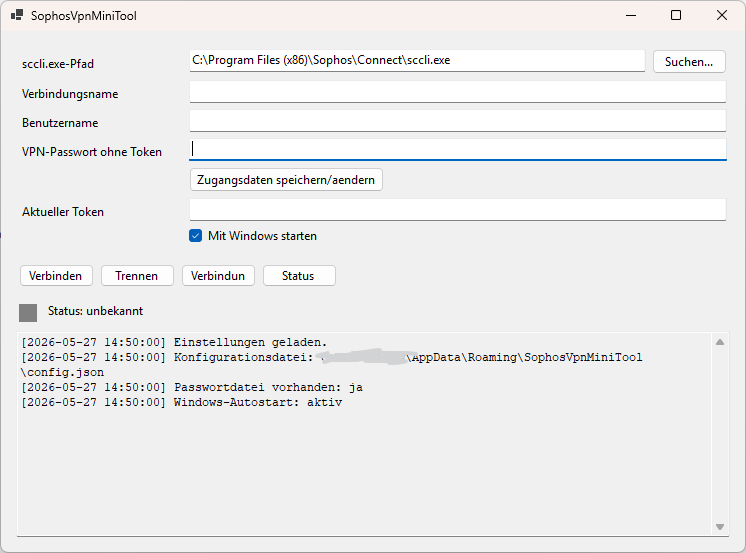

# SophosVpnMiniTool
Wer kennt es nicht, Sophos Connect mit einem TOTP-Token, Zugangsdaten werden nicht gespeichert, der Token ändert sich und es muss alles erneut eingegeben werden. 

Kleines Windows-Desktop-Tool zur Steuerung einer Sophos-Connect-VPN-Verbindung ueber die vorhandene `sccli.exe`.

Die Anwendung speichert das normale VPN-Passwort lokal verschluesselt per Windows-DPAPI. Beim Verbinden wird nur der aktuelle Microsoft-Authenticator-TOTP-Token eingegeben. Das Tool kombiniert intern `Passwort + Token` und uebergibt diesen Wert direkt an Sophos Connect.



## Voraussetzungen

- Windows
- Sophos Connect muss installiert sein
- Standardpfad der CLI:

```text
C:\Program Files (x86)\Sophos\Connect\sccli.exe
```

Die Sophos-Verbindung muss so konfiguriert sein, dass sie Passwort und Token als ein kombiniertes Passwort akzeptiert. Das Tool funktioniert nicht, wenn Sophos Connect eine separate OTP-Abfrage erzwingt.


## Kurzanleitung

1. `sccli.exe`-Pfad pruefen oder ueber `Suchen...` auswaehlen.
2. Verbindungsname eintragen.
3. Benutzername eintragen.
4. VPN-Passwort ohne Token eintragen und `Zugangsdaten speichern/aendern` klicken.
5. Aktuellen 6-stelligen Token eingeben.
6. `Verbinden` klicken.
7. Zum Trennen `Trennen` klicken.

Mit `Verbindungen anzeigen` oder `Status aktualisieren` wird `sccli.exe list -d` ausgefuehrt. Wenn die Ausgabe einen Verbindungsstatus erkennen laesst, aktualisiert das Tool die Ampelanzeige.

## System-Tray und Autostart

Beim Schliessen des Fensters wird die Anwendung in den Windows-Infobereich minimiert und laeuft weiter. Ueber das Tray-Menue sind diese Aktionen verfuegbar:

- `Oeffnen`
- `Verbinden...` oeffnet das Fenster und setzt den Fokus auf das Token-Feld
- `Trennen`
- `Status aktualisieren`
- `Beenden`

Der Windows-Autostart kann in der Anwendung ueber `Mit Windows starten` aktiviert werden. Dafuer wird ein Eintrag im Benutzerkontext unter folgendem Registry-Pfad geschrieben:

```text
HKCU\Software\Microsoft\Windows\CurrentVersion\Run
```

Dafuer sind keine Administratorrechte erforderlich.


## Voraussetzungen zum Verändern

- Windows
- .NET 10 SDK zum Bauen
- Sophos Connect muss installiert sein
- Standardpfad der CLI:

```text
C:\Program Files (x86)\Sophos\Connect\sccli.exe
```

Die Sophos-Verbindung muss so konfiguriert sein, dass sie Passwort und Token als ein kombiniertes Passwort akzeptiert. Das Tool funktioniert nicht, wenn Sophos Connect eine separate OTP-Abfrage erzwingt.

## Build und Start

```powershell
dotnet build
dotnet run --project .\SophosVpnMiniTool\SophosVpnMiniTool.csproj
```

Alternativ kann die Solution `SophosVpnMiniTool.sln` direkt in Visual Studio geoeffnet werden.

## Release und Code-Signing

Ein Self-contained Single-File-Release fuer Windows x64 kann so erstellt werden:

```powershell
dotnet publish .\SophosVpnMiniTool\SophosVpnMiniTool.csproj -c Release -r win-x64 --self-contained true /p:PublishSingleFile=true /p:IncludeNativeLibrariesForSelfExtract=true /p:EnableCompressionInSingleFile=true -o .\dist\SophosVpnMiniTool-win-x64
```

Damit Microsoft Edge, Windows SmartScreen und Windows Explorer den Herausgeber verifizieren koennen, muss die erzeugte `SophosVpnMiniTool.exe` mit einem vertrauenswuerdigen Code-Signing-Zertifikat signiert werden. Reine Assembly-Metadaten wie `Company` oder `Product` setzen nur die Dateieigenschaften, ersetzen aber keine digitale Signatur.

Beispiel mit SignTool und installiertem Code-Signing-Zertifikat:

```powershell
signtool sign /fd SHA256 /tr http://timestamp.digicert.com /td SHA256 /n "Name im Zertifikat" .\dist\SophosVpnMiniTool-win-x64\SophosVpnMiniTool.exe
```

Fuer oeffentliche Verteilung ist ein Code-Signing-Zertifikat einer vertrauenswuerdigen Zertifizierungsstelle sinnvoll. Ein selbstsigniertes Zertifikat eignet sich nur fuer interne Umgebungen, wenn das Zertifikat auf den Zielgeraeten als vertrauenswuerdig verteilt wird.


## Speicherung

Konfiguration:

```text
%APPDATA%\SophosVpnMiniTool\config.json
```

Enthaelt nur:

- `SccliPath`
- `ConnectionName`
- `Username`

Verschluesseltes Passwort:

```text
%APPDATA%\SophosVpnMiniTool\vpn-password.dpapi
```

Das Passwort wird mit Windows-DPAPI (`ProtectedData.Protect`, Scope `CurrentUser`) verschluesselt. Es ist damit nur fuer denselben Windows-Benutzer auf demselben Windows-System entschluesselbar.

## Sicherheitsnotizen

- Der Token wird nicht gespeichert.
- Das VPN-Passwort wird nicht in `config.json` gespeichert.
- Das Tool schreibt keine Passwoerter oder Token ins Log.
- `sccli.exe` wird ohne Shell gestartet (`UseShellExecute = false`) und die Argumente werden ueber `ArgumentList` uebergeben.
- Durch die Speicherung des VPN-Passworts auf dem Client haengt die Sicherheit wesentlich vom Schutz des Windows-Benutzerkontos und des Geraets ab.
- Wenn DPAPI das Passwort nicht mehr entschluesseln kann, muss das VPN-Passwort in der Anwendung neu gespeichert werden.
